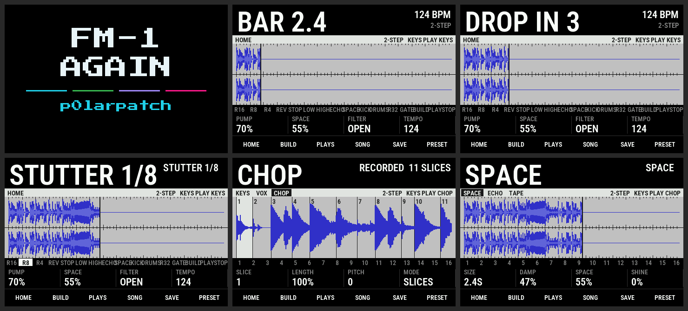

# FM-1 Again VIBE

[FM-1 Again](https://github.com/PolarPatch/FM-1-Again) by PolarPatch as a native firmware for **VIBE FM**: a plugin in
your DAW (VST3 / AU / CLAP through VIBE FM VST), a page in your browser (the Playground) and an instrument on the VIBE
FM hardware. Built with the VIBE FM SDK. Warm, emotional, rhythmic electronic music, made again: eight garage and house
grooves with chords pumping under the kick, electric piano, sung syllables or a chopped sample on the keys, tricks on
the pads, builds and drops.

## What the FM-1 cannot, and this can

- **Sound in, straight into CHOP.** Press REC and sing, play or hold a microphone to a room; REC again. The recording is
  cut where its sound starts again and plays on the keys and the 16 pads at once. Up to a minute (the FM-1: 8 s). The
  project keeps it.
- **Long samples.** Drop a WAV on the plugin's window, or LOAD one from the VIBE's card or a USB stick (F6 on CHOP's
  page): any rate, 16, 24 or 32 bit or float, mono or stereo, up to a minute, cut into slices.
- **The 16 pads:** PERFORM's thirteen tricks while held (stutters, reverse, tape stop, sweeps, echo and space throws,
  kick out, drums out), BUILD, PLAY and STOP; with CHOP on the keys, its slices.
- **The DAW:** every value is a parameter to automate; the DAW's tempo and PLAY lead; the project keeps the settings.
- **The big display** in FM-1 Again's black-and-white poster look, the sound drawn as an audio editor draws a track.

## The controls

| Control | Does |
| --- | --- |
| Keys | What encoder A chose: KEYS (a chord on one key), VOX, CHOP, RISE or DRUMS |
| Encoders 1-4 | The page's four values · **B**: the page's main choice |
| K1-K6 | SOUND (KEYS, VOX, CHOP) · PUMP · GROOVE (GROOVE, RISE) · BUILD · FX (SPACE, ECHO, TAPE) · MIX (MIX, SETUP); again: the next page |
| PLAY · STOP · REC | The groove · REC: IN 1 into CHOP |
| F1-F6 | HOME · BUILD, then DROP · what the keys play · LOOP / SONG · SAVE · the page's main choice on (CHOP: LOAD) |
| Pads | Tricks while held, BUILD, PLAY, STOP; CHOP's slices |
| HOME · RETURN | The controls on this page · back to HOME |

## Build

    git clone https://github.com/Vibe-FM-SDK/vibe-fm-sdk sdk
    tools/sync_engine.sh        # the engine from FM-1 Again beside this folder (AGAIN=/path/to/FM-1-Again)
    tools/build.sh check        # build/fm1-again-vibe.{wasm,zip}, vibe-check
    tools/build.sh emu          # and play it in the SDK's emulator

Drop `build/fm1-again-vibe.zip` on VIBE FM VST's window. Developer notes: [DEVELOPER.md](DEVELOPER.md).

## Licence

GPL-3.0-or-later ([LICENSE](LICENSE), every part in [LICENSING.md](LICENSING.md)). Built with the VIBE FM SDK
(Apache-2.0). FM-1 Again is not made, endorsed or approved by any artist.
